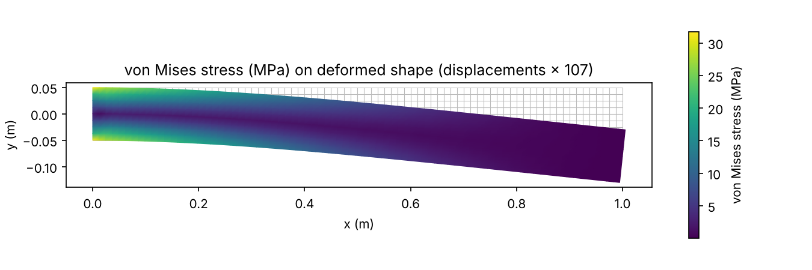
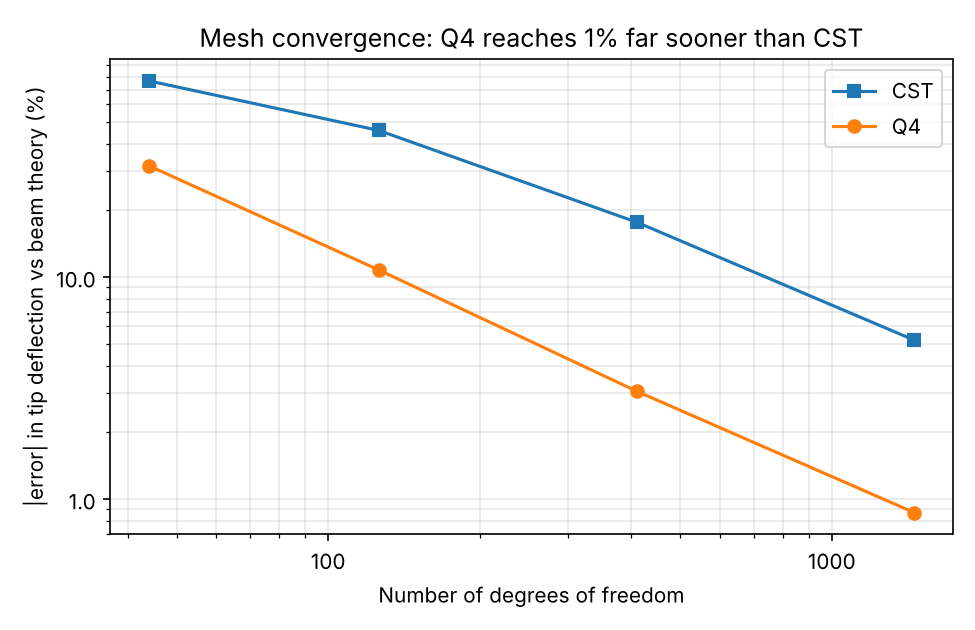
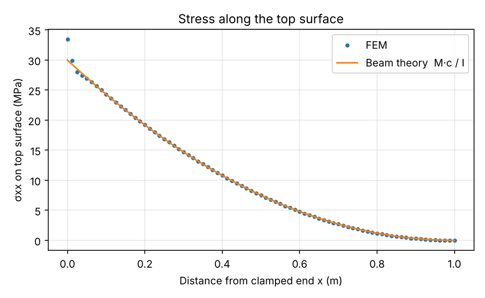

# FEM-2D: A Verified Plane-Stress Finite Element Solver for Clamped Bars Under Pressure

[](https://github.com/arbhadra/fem2d-web/actions/workflows/tests.yml)

**Live demo:** https://arbhadra.github.io/fem2d-web/

## Abstract

This project implements the displacement-based finite element method for 2D linear elasticity under plane
stress. It uses constant-strain triangles (CST) and bilinear isoparametric quadrilaterals (Q4) with Gauss
quadrature, written from first principles in Python (NumPy only). A clamped bar under transverse or axial
pressure is analysed for six engineering and additively manufactured materials, or for user-defined properties.
The solver reports displacement, strain, stress and a yield-based safety factor. Verification comprises
rigid-body-mode checks, the patch test, global equilibrium and comparison with Timoshenko beam theory. Q4
converges to within 0.9% of the analytical tip deflection, while CST shows the expected shear locking. Peak stress
at the clamped corner does not converge, consistent with a stress singularity. The solver runs in the browser via
PyScript/WebAssembly.



## Problem

A rectangular bar (length *L*, height *h*, thickness *t*) is clamped on its left edge. A uniform pressure *p*
acts on its top face (bending) or its right end (tension). With small strains, linear elasticity and plane
stress, the solver computes displacement, strain and stress, and compares them with beam theory.

**Materials:** structural steel A36, stainless 304, aluminium 6061-T6, Ti-6Al-4V, 3D-printed PLA and ABS
(typical handbook values), or **custom** E, ν and yield strength.

**Outputs:** contour plots (von Mises, σxx, τxy, εxx) on the deformed shape; a pressure-vs-stress graph
with the first-yield pressure; top-surface stress vs beam theory; and a results table with the safety factor.

## Code

| File | Content |
| --- | --- |
| `fem/materials.py` | Material presets, plane-stress D matrix |
| `fem/mesh.py` | Structured Q4 / CST meshes |
| `fem/elements.py` | CST (closed form), isoparametric Q4 with Gauss quadrature |
| `fem/solver.py` | Assembly, pressure loads, partitioned solve, reactions |
| `fem/post.py` | Nodal strains and stresses, von Mises |
| `fem/analytic.py` | Beam-theory reference solutions |
| `fem/model.py` | `run_case`, `load_sweep`, `convergence_study` |
| `fem/plotting.py` | All figures |
| `main.py`, `index.html` | The website |

## Verification (14 automated tests, run on every push)

D matrix vs textbook · 3 rigid-body modes per element (5 with 1-point Q4: hourglass) · patch test on a
distorted mesh · reactions = applied force · tension ε = p/E · bending converges to beam theory
(−0.87% at 80 × 8 Q4) · linear scaling with pressure · `tests/test_web.py` runs the website code
against a simulated page, so start-up and button errors are caught before deployment.

| Mesh convergence | Top-surface stress |
| --- | --- |
|  |  |

## Run locally

```bash
pip install -r requirements.txt
python -m pytest -v
python scripts/make_figures.py
python -m http.server 8000      # open http://localhost:8000
```

## Limitations

Linear elastic, small strain, 2D plane stress, structured meshes, dense solver. The clamped corners are stress
singularities, so peak stress (and therefore the safety factor) depends on the mesh. 3D-printed properties
depend on print settings.

## References

- J. Fish and T. Belytschko, *A First Course in Finite Elements*, Wiley.
- D. L. Logan, *A First Course in the Finite Element Method*, Cengage.
- R. D. Cook et al., *Concepts and Applications of Finite Element Analysis*, Wiley.

## How to cite

```
arbhadra (2026). FEM-2D: A verified plane-stress finite element solver for clamped bars under pressure.
https://github.com/arbhadra/fem2d-web
```

## Author

arbhadra. B.Sc. Mechanical Engineering (2024). Code structure drafted with AI assistance; every
derivation, test and result reproduced and checked by the author.

## Updating the live site

After changing any `.py` file, bump the `?v=` version in `index.html` and `pyscript.toml` (the test suite checks they match). Otherwise browsers may keep running a cached old copy for up to 10 minutes.
